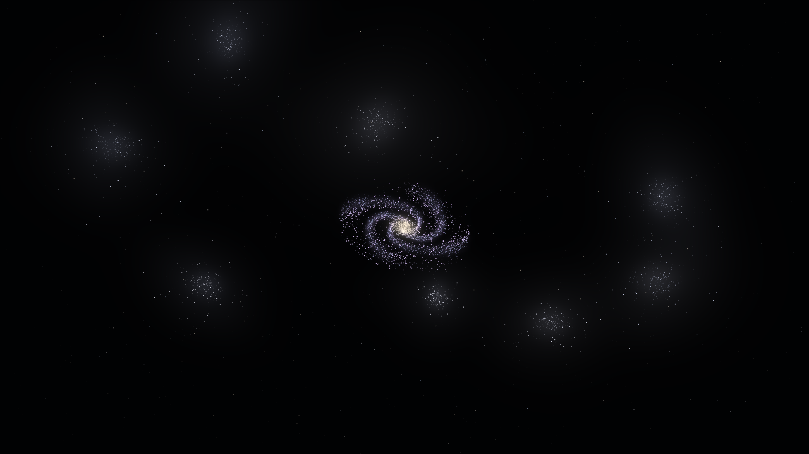
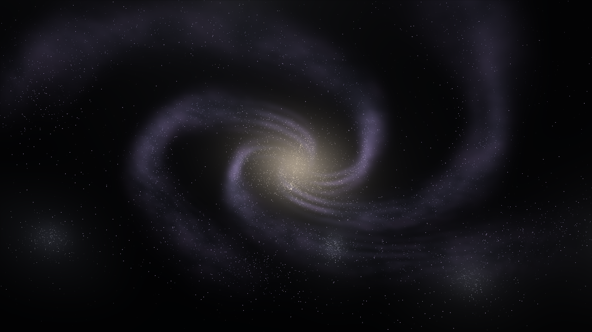
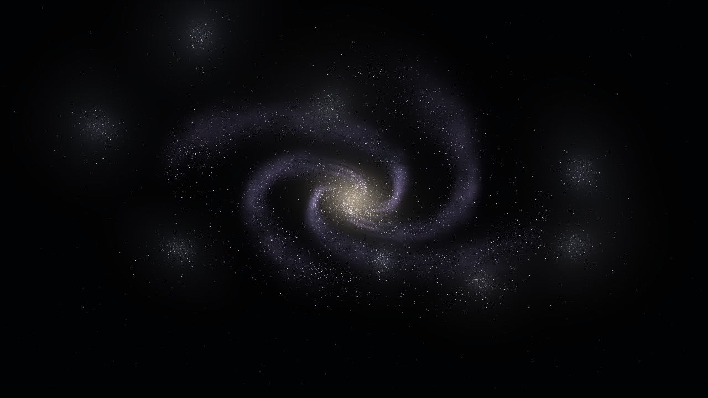

# Gesture Galaxy for TouchDesigner

[简体中文](README.md) · English

Close your fist to draw four spiral arms in toward the galactic core. Open your palm to stretch them out again. Gesture Galaxy is a Windows TouchDesigner project with MediaPipe hand tracking, volumetric nebulae and eight orbiting star clusters. You can also explore it with a mouse.

[Download the latest project ZIP](https://github.com/troulierkilian-blip/gesture-galaxy-touchdesigner/releases/latest) · [Windows setup](#windows-setup) · [Validation notes](docs/VALIDATION.md) · [MIT license](LICENSE)

| Fist · contract | Open palm · expand |
| :---: | :---: |
|  |  |

Both images are GPU renders from the project at fixed control states. Once the project opens, try these two states under **输入方式 → 鼠标模拟** (Input → Mouse simulation). Move the mouse over the galaxy to rotate it, press the left button for a fist and the right button for an open palm.

## Windows setup

1. Extract the entire project ZIP from **Assets** on the release page. Install and activate [TouchDesigner](https://derivative.ca/download) separately. The project was tested with **TouchDesigner 2025.33230 Non-Commercial** at 1280 × 720.
2. Open PowerShell in the extracted folder. Run the dependency installer once. It downloads the pinned MediaPipe for TouchDesigner plugin (about 188 MB) and matching hand-tracking files, then verifies their hashes. Keep the directory structure intact.

   ```powershell
   powershell -NoProfile -ExecutionPolicy Bypass -File .\Setup-Dependencies.ps1
   ```

3. Double-click **Start-GestureParticles.cmd**. The launcher opens the main **GestureParticles.toe** project. Camera tracking needs a camera; choose the device in the right panel and use **重新连接摄像头** (Reconnect camera) if necessary. Mouse simulation still uses the installed TouchDesigner project and its dependencies.

## Try the hand controls

| Input | What changes |
| --- | --- |
| Move one hand sideways or vertically | Rotate the galaxy or tilt it. Holding still preserves the viewing angle. |
| Hold a thumbs-up for about half a second | Toggle rotation and translation. In translation mode the galaxy and surrounding clusters move together. |
| Close a fist or open a palm | Contract the spiral or expand its arms. |
| Pinch thumb and index finger | Brighten the central core and nebula. |
| Move two hands apart or together | Zoom in or out. |
| Make a V sign | Cycle between blue-violet, cyan-blue and gold-orange palettes. |
| Move both hands out of view | The galaxy recenters and resumes slow rotation at the current viewing angle. |

Select **复位视角** (Reset view) to return to the initial oblique view. The Chinese control panel also has separate rotation and translation sensitivity settings.



## Project files, tests and licensing

The project defaults to 20,000 stars. For the historical 10-minute render measurement, machine details and native test scope, see the [validation report in Chinese](docs/VALIDATION.md). Live gesture recognition depends on the camera, lighting and hand visibility.

The control code and shaders are in [src](src/). After installing the dependencies, open **build/Bootstrap.toe** in TouchDesigner to rebuild the network. To run the pure Python logic tests with Python 3.10 or newer:

```powershell
python -m unittest discover -s tests -p 'test_*.py' -v
```

Project code and shaders use the [MIT license](LICENSE). The [pinned dependency manifest](dependencies.json) identifies the upstream [MediaPipe for TouchDesigner](https://github.com/torinmb/mediapipe-touchdesigner) release. Third-party components have their [own terms](THIRD_PARTY_LICENSES/NOTICE.txt). TouchDesigner requires a separate host license. See the [Chinese README](README.md) for rebuild details and project support.
