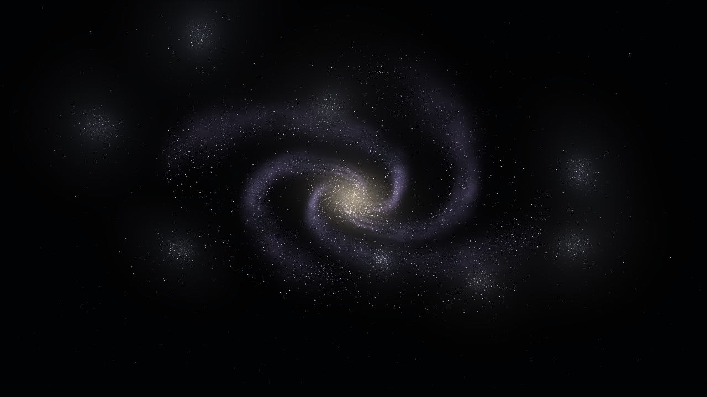
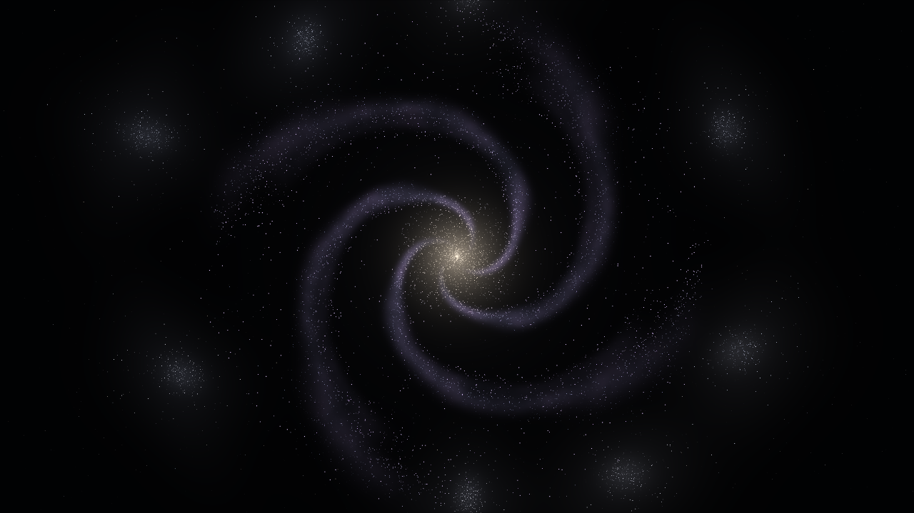
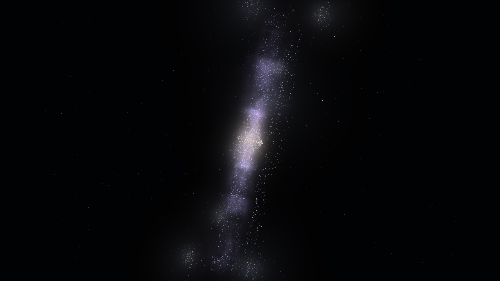
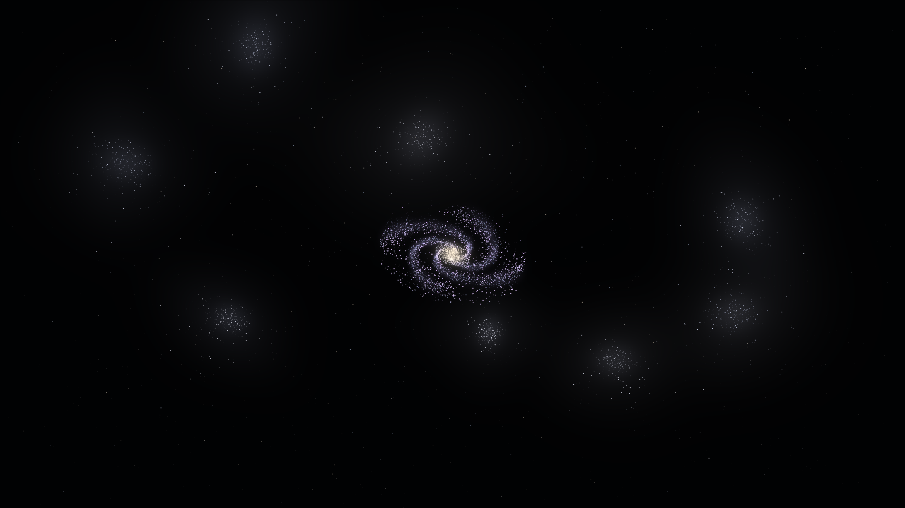
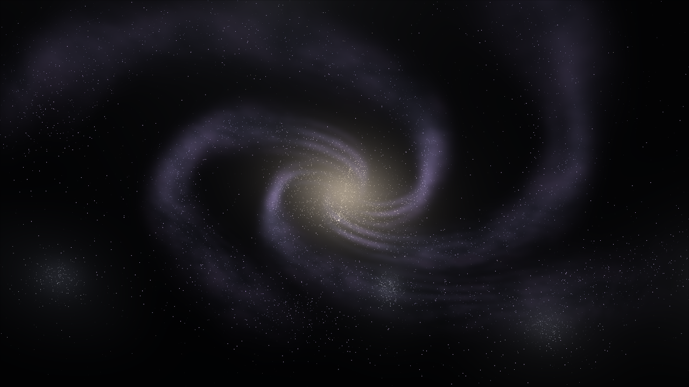

# Gesture Galaxy · 手势三维银河

用手掌旋转和移动三维银河，握拳收拢旋臂，张掌舒展星云。暖白银心、四条蓝紫旋臂、八个环绕星团与轻薄云雾全部由程序生成。

An interactive 3D spiral galaxy for TouchDesigner, controlled by MediaPipe hand tracking. Includes volumetric nebulae, eight surrounding star clusters, gesture rotation, translation, zoom and palette switching.



[下载 v1.0.0 工程包](https://github.com/troulierkilian-blip/gesture-galaxy-touchdesigner/releases/tag/v1.0.0) · [历史验收结果](docs/VALIDATION.md) · [MIT 许可](LICENSE)

## 首次运行（Windows）

1. 下载 Release 工程 ZIP，或使用 GitHub 的 **Code → Download ZIP**，解压整个文件夹。
2. 从 [Derivative 官网](https://derivative.ca/download)安装 TouchDesigner，使用自己的账号激活许可。本项目实测版本为 **2025.33230 Non-Commercial**，输出为 **1280×720**；宿主许可与本项目 MIT 许可相互独立。
3. 在项目目录打开 PowerShell，下载固定版本依赖：

   ```powershell
   powershell -NoProfile -ExecutionPolicy Bypass -File .\Setup-Dependencies.ps1
   ```

   首次需要从上游下载约 188 MB 的插件。脚本校验 SHA-256，补齐同提交的手部组件和脚本。中断后可再次运行，下载会继续；没有通过校验的文件不会安装。
4. 双击 **Start-GestureParticles.cmd**，等待摄像头与模型初始化。打开摄像头的物理遮挡开关。

TouchDesigner 程序、安装包、账号、激活信息及模型权重不包含在工程 ZIP 中。依赖脚本只从固定的上游公开地址下载，不需要 GitHub 令牌。

启动器按以下顺序查找 TouchDesigner：`TOUCHDESIGNER_EXE` 环境变量、项目内的便携运行环境、Program Files 下的 Derivative 安装目录、系统 PATH。自定义位置可这样运行：

```powershell
$env:TOUCHDESIGNER_EXE = 'C:\Program Files\Derivative\TouchDesigner\bin\TouchDesigner.exe'
.\Start-GestureParticles.cmd
```

设备列表来自本机。没有相机画面时，选择右侧摄像头并点击“重新连接摄像头”；关闭独占摄像头的软件。系统摄像头权限需要由使用者自行开启。

## 手势操作

默认进入“旋转视角”。右手优先，只有左手时自动接管；手重新入镜、换手、切换模式和双手缩放结束时会重新建立拖动起点。

| 操作 | 响应 |
| --- | --- |
| 单手左右 / 上下移动 | 水平旋转 / 调整俯仰；手停下后保持角度 |
| 竖拇指保持约半秒 | 切换“旋转视角 / 移动银河”，也可点击面板切换 |
| 移动模式中移动手掌 | 银河与外围星团一起移动 |
| 握拳 | 主体收拢，外围星团保持环绕半径 |
| 张开手掌 | 旋臂舒展，外围星团适度外展 |
| 拇指和食指捏合 | 银心和主星云增亮，外围光晕轻微增强 |
| 双手拉开 / 靠拢 | 整体放大 / 缩小，期间暂停视角拖动 |
| V 手势 | 切换蓝紫、青蓝、金橙；银心保留暖白 |
| 双手离开画面 | 银河回中，保持观察角度并恢复慢自转 |
| 点击“复位视角” | 平滑返回初始约 55° 斜视角 |

水平旋转可连续多圈，俯仰范围为 ±80°。竖拇指置信度门槛为 0.75、持续 0.5 秒、冷却 1 秒；保持姿势只切换一次，放下至少 0.2 秒后重新触发。识别效果受光线与遮挡影响。

右侧点击文字切换选项，“− / ＋”调数值。旋转和移动灵敏度独立。最大放大时部分外围结构会超出画面，可缩小后观察完整星系。

## 鼠标模拟

将“输入方式”切换到“鼠标模拟”，在银河画面中移动鼠标。当前操作模式决定旋转或平移；左键模拟握拳、右键模拟张掌。面板还可选择捏合、V、竖拇指及缩放。模拟模式用于检查视觉管线，不代表真实识别准确率。

## 画质与历史性能

- 默认 20,000 星点：65% 主银河、25% 环绕星团、10% 稳定背景。
- 主星云为 640×360、16 步体积采样，合成至 1280×720；辉光 0.32、拖尾 0.08。
- 星点、星云与外围星团共用三维变换，支持正面、侧面和背面观察。

2026-10-23 在 RTX 3060 Laptop 6GB、真实摄像头模式下，连续 **600.02 秒**：平均 **58.97 FPS**，最低 **52.17 FPS**，保持默认画质。这是特定硬件上的历史测量，不是所有设备的帧率保证。增强版的真人操作反馈尚待确认，自动模拟通过不能替代真人识别验收。详见 [验收摘要](docs/VALIDATION.md)。

性能不足时，先改为 10,000 星点、拖尾 0.05；仍不足再在源码中降低星云分辨率和采样数，重建后测试。相机采集目标为 30 FPS，渲染帧率与采集帧率是两个指标。

| 正面 | 侧面 |
| --- | --- |
|  |  |

| 握拳收拢 | 张掌舒展 |
| --- | --- |
|  |  |

## 源码与重建

`GestureParticles.toe` 是可打开的主工程。运行依赖下载脚本后，用 TouchDesigner 打开 `build/Bootstrap.toe` 可从 `src/` 重建生成网络并保存主工程。保存前会将已有生成文件留在本地 `build/backups/`，自行修改的工程仍应另行备份。

主要控制器为 `gesture_control.py` 与 `orbit_control.py`；着色器形状共用 `galaxy_common.glsl`，由 `shader_source.load_source()` 展开后嵌入工程。`uMotion` 保留聚散、缩放和辉光，`uControl` 保留中心、星点数和配色，`uView` 传递弧度制角度，`uProjection` 从相机读取视锥参数。

无需安装额外 Python 包即可运行逻辑测试（Python 3.10 或更新版本）：

```powershell
python -m unittest discover -s tests -p 'test_*.py' -v
```

GitHub Actions 运行这些纯 Python 测试。`tests/enhanced_*.py` 是 TouchDesigner 内的原生检查脚本，不能作为普通命令行测试直接运行。正常主工程关闭开发文件通道；只有显式设置 `GESTURE_PARTICLES_VALIDATE=1` 的本地开发进程才启用它。

`tools/package_release.py` 使用公开文件白名单生成工程 ZIP、文件清单及 SHA-256。运行环境、依赖下载缓存、原始交互坐标、摄像头画面和本机日志不进入发布包。

## 来源与许可

新增代码与着色器采用 [MIT](LICENSE)。上游 [torinmb/mediapipe-touchdesigner](https://github.com/torinmb/mediapipe-touchdesigner) 固定 **v0.6.0**、提交 `bb01606926edeec828cc123e86a4a300bdc96c9b`，保留 [Torin Blankensmith 的 MIT 许可](THIRD_PARTY_LICENSES/mediapipe-touchdesigner-MIT.txt)。该发行包缺少手部组件，下载脚本从同一提交补齐，未混用旧版组件。

MediaPipe SDK、模型及其他依赖继续适用其上游许可；TouchDesigner 是单独安装和许可的专有软件。参见 [第三方说明](THIRD_PARTY_LICENSES/NOTICE.txt) 与 [固定依赖清单](dependencies.json)。
